# 🇰🇷 K-SAFE — 국민안심 AI

**금융사기가 의심되는 상황에서 다음 안전행동을 안내하는 웹 데모입니다.**

**2026-10-30 현재** · [LIVE 공개 데모](https://k-safe-ai-hackathon-2026.vercel.app/) · [GitHub 저장소](https://github.com/MetaStudy999/k-safe-ai-hackathon-2026)


[표지 원본 PNG](docs/08-presentation/assets/k-safe-cover.png) · [발표 슬라이드 디자인 가이드](docs/08-presentation/K-SAFE-SLIDE-DESIGN-SYSTEM.md)

> **공개 범위:** 사용자 메시지를 입력받지 않고, 미리 작성된 가상 사례로 상황별 안전행동을 안내합니다. 실제 메시지 사기 탐지·실시간 AI/대형언어모델(LLM)·수사기관 및 금융회사 연동·AI 판정 서비스가 아닙니다.
>
> **실제 문자·계좌·비밀번호 입력 금지.** 개발·시연·검증에는 합성 사례만 사용하세요. 실제 송금 피해가 의심되면 데모 결과를 기다리지 말고 112 및 거래은행 등 해당 금융회사에 연락하세요.

## 0. 프로젝트 소개와 읽는 순서

K-SAFE는 개인정보 유출, 금융기관 사칭, 보이스피싱·스미싱으로 인한 추가 피해를 줄이는 것을 목표로 합니다. 금융사기에 익숙하지 않은 이용자도 **위험 단서 → 다음 행동 → 공식 확인 경로**를 이해하도록 돕고자 합니다. 2026 AI 해커톤에서 AI 기반 추천·정보보호 서비스를 기획했으며, 현재 공개한 결과물은 **가상 사례 기반의 안전행동 안내 화면**입니다.

- **심사자:** LIVE 데모에서 아래 시연 순서를 따라 본 뒤, 상태표와 검증 한계를 확인하세요.
- **팀원·개발자:** 빠른 시작에서 공개 데모를 로컬 프로덕션 방식으로 재현하고, 구조와 문서 목차를 확인하세요.
- **기획 기능:** 의심 메시지 입력, 개인정보 가림, 규칙·AI 기반 설명, 상황별 추천의 통합 서비스는 향후 계획입니다. 개발용 규칙 분석기는 존재하지만 실서비스 분석 오픈은 보류합니다.

### README 목차

1. [공개 데모 시연 순서](#1-공개-데모-시연-순서)
2. [공개·개발·검증 상태](#2-공개개발검증-상태)
3. [빠른 시작 (Quick Start)](#3-빠른-시작-quick-start)
4. [구현 기술과 아키텍처](#4-구현-기술과-아키텍처)
5. [실제 저장소 구조](#5-실제-저장소-구조)
6. [전체 로드맵: 00~08](#6-전체-로드맵-0008)
7. [보안·윤리·안전 원칙](#7-보안윤리안전-원칙)
8. [심사자·팀원용 재현 절차](#8-심사자팀원용-재현-절차)
9. [문서 목차](#9-문서-목차)
10. [향후 과제와 발표 준비](#10-향후-과제와-발표-준비)
11. [자주 쓰는 용어](#11-자주-쓰는-용어)

## 1. 공개 데모 시연 순서

1. **상황 선택:** `송금 전` / `이미 송금` / `앱 설치함` / `잘 모르겠음` 중 하나를 선택합니다.
2. **가상 사례 확인:** 해당 상황에 미리 연결된 가상 메시지와 위험 단서 설명을 읽습니다. 사용자의 메시지를 분석하거나 단서를 자동 탐지하는 과정이 아닙니다.
3. **다음 행동 확인:** 권장 행동과 112·118 안내, 금융회사의 공식 경로로 직접 확인하는 방법을 살펴봅니다. 실제 신고 접수·전화 연결·지급정지 처리는 데모가 수행하지 않습니다.

화면은 PC·모바일 반응형이며, 상단·모바일 내비게이션으로 가이드·사례·안전수칙·도움받기를 이동할 수 있습니다. 긴급 행동을 눈에 띄게 표시하고, 키보드로 상황 선택과 메뉴·모달을 이용할 수 있도록 구현했습니다. 전체 접근성을 인증받았다는 뜻은 아닙니다.

화면 참고: [데스크톱 캡처](artifacts/ui/final/desktop-1440x900.png) · [모바일 캡처](artifacts/ui/final/mobile-390x844.png). 두 이미지는 Git에 추적되는 UI 검증 자료이며, 운영 주소의 실시간 화면을 보장하지 않습니다.

## 2. 공개·개발·검증 상태

아래는 **2026-10-30 확인 기록** 기준입니다. 배포 상태와 분석 품질은 별도로 판단합니다.

| 구분 | 현재 상태 | 범위·한계 |
|---|---|---|
| 공개 가상 사례 사용자 화면(UI) | 공개 | 네 상황의 정해진 메시지·단서·안전행동 표시, 사용자 메시지 입력 없음 |
| 배포 | Vercel Production, READY 기록 | 공개 가상 시연 배포 완료. 실제 분석 서비스 개방을 뜻하지 않음 |
| 규칙 기반 로컬 분석기 | 개발 모드에서 사용 | `npm run dev`의 `/` 및 `/lab`에서 합성 사례로만 확인 |
| 공개 분석 API | 미개방 | `POST /api/analyze`는 HTTP 503, `Cache-Control: no-store` 기록 |
| 외부 AI 모델·LLM | 미연결 | 공개 UI에 서버 AI 호출 없음. 로컬 분석도 규칙 기반 |
| 독립 탐지 품질 평가(05-6) | 품질 판정 보류 | 독립 합성 데이터 미수령·평가 미실행 |
| 운영 보안 검증 | 미완료 | 실효성 있는 웹 방화벽(WAF)의 HTTP 429, 서버 로그, 장기 운영 모니터링 미검증 |

### 공개 주소와 기존 검증 기록

| 운영 주소의 경로·요청 | 2026-10-30 확인 결과 |
|---|---|
| `GET /` | HTTP 200, 공개 데모 표시 |
| `GET /lab` | HTTP 404, 프로덕션에서 개발용 화면 비공개 |
| `POST /api/analyze` | HTTP 503, 응답 저장 금지(`Cache-Control: no-store`) |

**근거는 `artifacts/deployment/DEPLOYMENT-20261030.md`의 로컬 배포 보고서 기록입니다.** 이 보고서와 같은 폴더의 운영 증거는 미추적 로컬 산출물이므로 GitHub 링크를 제공하지 않습니다. 저장소를 새로 복제하면 포함되지 않을 수 있습니다.

- Vercel **READY**, 배포 커밋 `b408827cf2e9e12555abb61eeb12ad8c1092f9bd`, 타입 검사·프로덕션 빌드 PASS가 기록되어 있습니다.
- 최신 자동 테스트 **65/65 PASS**, 로컬 Playwright **8/8 PASS**, **실제 운영 주소의 Chromium Playwright 8/8 PASS**가 기록되어 있습니다. 자동 테스트 수는 탐지 정확도나 독립 평가 사례 수가 아닙니다.
- 화면 너비(뷰포트, viewport) **320·375·390·768·1024·1440px**에서 네 상황과 레이아웃 검사를 통과한 기록이 있습니다. 검사 범위에서 가로 스크롤·겹침·주요 텍스트 넘침은 발견되지 않았습니다.
- axe 자동 접근성 검사에서 **390·1440px 탐지 위반 0건**이 기록되어 있으나, 일부 이미지 배경 대비는 판정 미완료(`incomplete`)입니다. 키보드·모바일 검사도 수행 범위에 한정됩니다.
- 운영 브라우저 검사 중 콘솔 오류·페이지의 분석 POST 요청은 각각 0건으로 기록되어 있습니다. 112·118은 실제 통화 대신 링크 목적지와 클릭 전달을 확인했습니다.

이 수치는 **기록된 조건에서의 기능 확인이며 독립 서비스 품질 인증이 아닙니다.** 서버 로그 조회는 권한·조회 오류로 판정하지 못했습니다. 브라우저 오류 0건을 서버 오류 0건으로 해석하지 않습니다. WAF의 실제 요청 제한과 05-6 독립 평가는 여전히 미검증이며, 기존 합성 자료를 반복 평가한 결과로 실제 금융사기 탐지 성능을 주장하지 않습니다.

## 3. 빠른 시작 (Quick Start)

준비물은 Git과 Node.js입니다. Windows에서는 WSL2(Ubuntu) 터미널을 사용할 수 있습니다. Node.js 버전은 [`.nvmrc`](.nvmrc)의 **24.22.0**을 기준으로 합니다.

### 기존 사용자: 이미 있는 WSL2 폴더로 이동

```bash
cd ~/codyssey/k-safe-ai-hackathon-2026
```

기존 폴더와 사용자 작업을 그대로 사용합니다. 실행을 위해 다시 복제하거나 작업 내용을 초기화할 필요는 없습니다.

### 신규 사용자: 처음 한 번만 복제

```bash
mkdir -p ~/codyssey
cd ~/codyssey
git clone https://github.com/MetaStudy999/k-safe-ai-hackathon-2026.git
cd k-safe-ai-hackathon-2026
```

### 공개 데모를 로컬 프로덕션 방식으로 실행

아래는 재현을 위한 실행 안내입니다. 의존성 설치·검사·빌드는 로컬 생성 파일을 변경할 수 있으므로 기존 작업 상태를 먼저 확인하세요. 현재 브랜치 이름은 사용자 환경에 따라 다릅니다.

```bash
git status
# nvm이 설치된 환경에서 Node.js 버전 맞추기
nvm install
nvm use
node --version
# 예상 Node.js 버전: v24.22.0
npm ci
npm run typecheck
npm test
npm run build
npm run start
```

브라우저에서 **http://127.0.0.1:3000/** 을 엽니다. `start`는 빌드 결과로 공개 데모를 보여주며, 기본 포트는 3000입니다. `nvm`이 없다면 Node.js 24.22.0을 별도로 준비한 뒤 `npm ci`부터 진행하세요.

### 개발용 규칙 분석기를 확인할 때만

**`npm run dev`는 공개 데모와 화면이 다릅니다.** 개발 모드의 `/`와 `/lab`은 합성 메시지로 규칙 분석기를 확인하는 용도입니다. 공개 UI 재현에는 위의 `build` → `start` 순서를 사용하세요.

개발 모드가 필요하면 실행 중인 `start`를 `Ctrl+C`로 종료한 뒤, 같은 저장소에서 다음 명령만 실행합니다.

```bash
npm run dev
```

`start`와 `dev`는 모두 **127.0.0.1:3000에 바인딩하여 로컬호스트에서만 접근**합니다. 두 서버를 동시에 실행하지 마세요. 기본 포트가 사용 중이면 기존 서버를 종료하고 다시 확인하세요. 개발 화면에도 실제 문자·계좌·비밀번호를 넣지 말고, 제공된 가상 예시만 사용하세요. 공개 분석 API의 차단을 해제하거나 우회하지 마세요.

## 4. 구현 기술과 아키텍처

| 역할 | 구현 |
|---|---|
| 웹 프레임워크 | Next.js **16.4.3**, App Router |
| 화면 구성 | React **19**, TypeScript, CSS 반응형 화면 |
| 공개 시나리오 | 미리 작성된 합성 메시지·위험 단서·상황별 행동 |
| 개발용 분석 | TypeScript 규칙 분석·개인정보 가림, 보호 API 경유 |
| 검증 도구 | Node.js 테스트, Playwright 브라우저 검사, axe 접근성 검사 |
| 공개 호스팅 | Vercel Production |

버전과 실행 명령은 [`package.json`](package.json), 의존성 고정 기록은 [`package-lock.json`](package-lock.json)에서 확인할 수 있습니다.

```mermaid
flowchart TB
  subgraph PUBLIC["공개 프로덕션: 사용자 메시지 입력·서버 AI 호출 없음"]
    P["방문자: 네 상황 중 선택"] --> UI["공개 UI / : public-demo.tsx"]
    DATA["public-demo.ts: 미리 작성된 가상 메시지·단서"] --> UI
    UI --> ACTION["상황별 안전행동·112/118·공식 금융회사 확인 안내"]
    LAB["/lab 요청"] --> HIDDEN["404: 개발 화면 비공개"]
  end
  subgraph BLOCK["공개 API 보호: 현재 운영 확인 상태"]
    POST["외부 POST /api/analyze"] --> GATE["deployment-gate.ts: 공개 차단 게이트"]
    GATE --> STOP["503 / no-store: 분석 미개방"]
  end
  subgraph LOCAL["개발 모드: 로컬 규칙 분석기, 합성 사례만"]
    DEV["127.0.0.1:3000의 / 또는 /lab"] --> FORM["local-analyzer.tsx: 개발용 입력 화면"]
    FORM --> API["POST /api/analyze: 개발 모드 허용"]
    API --> GUARD["request-guard.ts: 요청 크기·형식 및 입력값 검사"]
    GUARD --> MASK["safety.ts: 개인정보 가림"]
    MASK --> RULE["safety.ts: 규칙 분석·상황별 행동"]
    RULE --> RESULT["로컬 결과 표시: 외부 AI 호출 없음"]
  end
```



공개 UI는 선택한 상황에 연결된 준비된 내용을 표시합니다. 로컬 분석기의 규칙 탐지 흐름과 분리되어 있으며, 공개 화면에서 분석 API를 호출하지 않습니다. 공개 API 게이트는 프로덕션에서 검증 표시가 없으면 요청을 차단하는 보조 장치입니다. 환경변수의 표시만으로 WAF의 실제 작동이 증명되지는 않습니다.

## 5. 실제 저장소 구조

아래는 Git 추적 경로에서 확인한 주요 구성입니다.

```text
README.md
.nvmrc / package.json / package-lock.json
src/
  app/
    page.tsx                 # 프로덕션 공개 UI / 개발용 분석기 분기
    public-demo.tsx          # 공개 가상 사례 화면
    local-analyzer.tsx       # 개발 모드 / 화면
    lab/                    # 개발 모드 한정 /lab 화면
    api/analyze/route.ts      # 분석 API 및 차단·입력 검사
    globals.css / layout.tsx
  lib/
    public-demo.ts           # 공개 가상 사례·단서·상황별 행동 연결
    safety.ts                # 로컬 규칙 분석·가림·행동 안내
    deployment-gate.ts       # 공개 API 차단 게이트
    request-guard.ts         # 요청 본문 보호
data/synthetic/              # 합성 평가 사례
tests/                       # 자동 테스트, browser/ 브라우저 검사
scripts/                     # 합성 평가·HTTP·공개 프로덕션 검사 도구
public/                      # 화면 이미지·폰트·라이선스
artifacts/ui/                # Git 추적 UI 캡처·검사 기록
docs/
  01-planning/
  02-requirements/
  03-design/
  04-implementation/
  05-verification/
  08-presentation/
```

06 배포·07 운영은 로드맵 단계입니다. 현재 Git에 없는 전용 문서 폴더나 README 링크는 만들지 않습니다. 미추적 로컬 배포 산출물과 디자인 작업 자료는 위 구조·문서 링크에서 제외했습니다.

## 6. 전체 로드맵: 00~08

| 단계 | 목적 | 검증 기준(게이트, Gate) | 2026-10-30 현재 |
|---|---|---|---|
| 00. 초기화 | README·기본 설정 | 저장소 및 기본 파일 확인 | PASS |
| 01. 기획 | 문제·대상·차별성 정의 | 대회 요건·공익성 확인 | 기획 문서 작성, 공식 대회 공고·AI 요건 확인 필요 |
| 02. 요구사항 | 기능·비기능·수용 기준 | 공개 범위와 계획 기능 구분 | 문서 작성, 공식 요건에 맞춘 재검토 필요 |
| 03. 설계 | 화면·데이터·API·보안 | 구조와 개인정보 처리 검토 | 설계 문서 작성, 운영 검증 필요 |
| 04. 구현 | 공개 UI·로컬 규칙 분석기 | 네 상황·반응형 화면·키보드 동작 | **공개 UI 반응형 완료**, 개발용 분석기 구현, 외부 LLM 미구현 |
| 05. 검증 | 기능·품질·보안 검사 | 기록된 조건과 독립 평가 구분 | **65 tests / 운영 브라우저 8 tests PASS**, **05-6 품질 보류**, WAF·서버 로그 미검증 |
| 06. 배포 | 공개 URL 제공 | 공개 가상 시연과 분석 개방 분리 | **공개 가상 시연 배포 PASS/실서비스 분석 미개방** |
| 07. 운영 | 장애·비용·로그 관리 | 운영 관측·대응 절차 확인 | 장기 모니터링·서버 로그·장애 대응 검증 필요 |
| 08. 발표 | 시연·증빙·효과 전달 | 자료·리허설·예비 영상 확인 | 디자인 가이드 존재, 발표 완성도·리허설 검증 필요 |

각 단계는 **목적 → 작업 → 산출물 → 검증 → 통과·실패(PASS/FAIL) → 다음 단계**로 기록합니다. 과거 문서에는 당시 테스트 수와 분석 서비스의 배포 승인 보류가 남아 있습니다. 현재 공개 가상 시연은 배포 완료이며, **분석 서비스 오픈 보류는 유지**합니다.

## 7. 보안·윤리·안전 원칙

- **실제 개인정보 금지:** 실제 문자 원문, 전화번호·계좌·주민번호·비밀번호·인증번호·접근토큰을 입력·업로드·커밋하지 않습니다. 개발·평가·발표에는 합성 사례만 사용합니다.
- **공개 API 보호 유지:** 공개 분석 API는 현재 503 응답으로 닫혀 있습니다. 검증을 위해 차단 게이트나 WAF를 우회하거나 설정을 임의로 해제하지 않습니다.
- **긴급 행동 우선:** 실제 송금 피해가 의심되면 112 및 거래은행 등 해당 금융회사에 연락하여 신고·지급정지를 문의하세요. 데모나 향후 AI 설명을 기다리지 않습니다. 의심 앱을 설치했다면 안전한 다른 기기로 공식 경로를 확인하세요.
- **공식 경로 확인:** 화면의 118 상담 안내와 금융회사 확인 안내를 참고하되, 문자 속 번호·링크 대신 직접 확인한 공식 연락처·앱·홈페이지를 이용하세요.
- **권한·기능의 한계:** 데모는 의심 URL을 대신 방문하거나, 송금·신고 접수·계좌차단을 실행하지 않습니다. 수사기관·금융회사와 연결된 처리 서비스가 아닙니다.
- **분석 품질·개인정보 보호의 한계:** 규칙 분석은 위험 누락·오경보가 가능하고 정규식 가림만으로 개인정보 제거를 보장할 수 없습니다. 독립 평가·운영 보안·로그 정책 검토 전 실제 메시지 분석을 공개하지 않습니다.

## 8. 심사자·팀원용 재현 절차

1. **버전 확인:** `git status`와 `git rev-parse HEAD`로 작업 상태·코드 버전을 확인합니다. 배포 보고서에 기록된 코드 커밋은 `b408827cf2e9e12555abb61eeb12ad8c1092f9bd`입니다. 이후 버전은 결과가 다를 수 있습니다.
2. **공개 시연 확인:** LIVE 주소 또는 빠른 시작의 로컬 `build` → `start`에서 네 상황을 차례로 선택하고, 가상 메시지·단서·긴급 행동·공식 확인 안내를 살펴봅니다. 실제 전화·신고·금융 거래를 실행할 필요는 없습니다.
3. **반응형·키보드 확인:** 브라우저 개발자 도구에서 390px·1440px 등 화면 너비를 바꾸고 메뉴·겹침·넘침을 확인합니다. `Tab`·방향키로 상황을 선택하고, 모달 닫기·`Escape`·포커스 복귀를 확인합니다.
4. **팀원 코드 검사:** 빠른 시작의 `typecheck` → `test` → `build` 결과를 구분해 기록합니다. `npm test`는 단위·회귀 검사이며 운영 Playwright 검사를 대신하지 않습니다.
5. **기존 브라우저·HTTP 근거 확인:** [브라우저 검사 코드](tests/browser/public-demo.spec.ts), [Playwright 설정](playwright.config.ts), [공개 프로덕션 HTTP 검사 코드](scripts/verify-public-production.mjs)를 읽습니다. 기존 운영 결과는 앞서 명시한 미추적 로컬 배포 보고서 기록을 기준으로 확인합니다. 코드나 캡처의 존재만으로 현재 운영 검사 PASS를 선언하지 않습니다.

검사 날짜·커밋·대상 주소·화면 너비·성공 및 미확인 범위를 함께 남겨야 재현 결과를 비교할 수 있습니다. 현재 README 문서 편집 작업에서는 테스트·빌드를 다시 실행하지 않았습니다.

## 9. 문서 목차

다음은 실제 파일이 있고 Git에 추적되는 문서·도구입니다. 과거 단계 문서는 작성 시점의 기록으로 읽고, 현재 공개 범위는 이 README의 상태표를 기준으로 확인하세요.

### 기획·요구사항·설계·구현

- 01: [기획서](docs/01-planning/README.md) · [2025~2026 공식 심사기준 비교 및 내부 평가표](docs/01-planning/JUDGING-CRITERIA-2025-2026.md)
- 02: [요구사항 명세·수용·보안·시험 기준](docs/02-requirements/README.md)
- 03: [시스템·화면·API·보안 설계](docs/03-design/README.md)
- 04: [구현 현황·Node.js·설치와 시험 방법](docs/04-implementation/README.md)

### 검증 기록과 평가 도구

- [05 종합 검증·합성 평가·보안 위험](docs/05-verification/README.md)
- [05-1 최초 측정 기준선](docs/05-verification/BASELINE-20261030.md) · [05-2 개선 후 측정 기록](docs/05-verification/POSTFIX-20261030.md)
- [05-3b 요청률 제한 설정](docs/05-verification/RATE-LIMIT-SETUP.md) · [05-3c 개인정보·악성 입력 검증 계획](docs/05-verification/PRIVACY-SECURITY-PLAN.md)
- [05-3c 로컬 HTTP 보안 검사 스크립트](scripts/verify-http-security.py) · [당시 로컬 HTTP 8/8 기록](docs/05-verification/HTTP-INTEGRATION-20261030.md)
- [05-4 분석 서비스 배포 전 승인 기준](docs/05-verification/PREDEPLOY-GATE.md) · [신규 합성 평가 도구](scripts/evaluate-holdout.ts) · [최초 실패 기준선](docs/05-verification/HOLDOUT-BASELINE-20261030.md)
- [05-5 문맥 개선 설계](docs/05-verification/CONTEXT-IMPROVEMENT-05-5.md) · [당시 개선·재평가 기록](docs/05-verification/CONTEXT-RESULT-05-5-20261030.md)
- [05-6 독립 작성 합성 자료 평가 방법](docs/05-verification/BLIND-EVALUATION-05-6.md) · [평가자 안내서](docs/05-verification/BLIND-EVALUATOR-GUIDE-05-6.md) · [빈 양식](docs/05-verification/blind-evaluation-empty.json)
- [UI 구현·검증 보고서](docs/05-verification/UI-REFERENCE-20261030.md) · [공개 데모 자동 테스트](tests/public-demo.test.ts)

### 발표

- [08 발표 슬라이드 디자인 시스템](docs/08-presentation/K-SAFE-SLIDE-DESIGN-SYSTEM.md) · [표지 이미지](docs/08-presentation/assets/k-safe-cover.png)

## 10. 향후 과제와 발표 준비

- **독립 품질 평가:** 별도 작성자의 새 합성 데이터를 수령하고, 정답·원본 해시를 고정한 뒤 05-6 최초 평가와 위험 누락·오경보 검토를 진행합니다.
- **운영 보안:** WAF의 실제 HTTP 429, 서버 로그 접근·오류 관측, 개인정보 최소 수집·보관, 장애 대응과 비용 관리 절차를 검증합니다.
- **기획 기능의 단계적 검토:** 의심 메시지 입력 → 개인정보 가림 → 규칙·LLM 설명 → 상황별 행동을 목표로 하되, 공식 대회 AI 요건·개인정보·모델 비용·오류 대응을 먼저 확인합니다. 현재 공개 기능으로 소개하지 않습니다.
- **후속 기능 후보:** 광학 문자 인식(OCR), QR 코드 분석, 보고서 내보내기는 추가 검토 대상입니다. 음성·실시간 통화 분석과 금융기관 직접 연동도 미래 과제입니다.
- **접근성·발표:** axe의 판정 미완료 항목을 수동 확인하고, 다양한 기기·보조기술 점검, 발표 리허설·예비 영상을 준비합니다. 사회적 효과와 탐지 성능은 확보된 근거의 범위에서만 설명합니다.

## 11. 자주 쓰는 용어

| 한글 | 영어·약어 | 뜻 |
|---|---|---|
| 저장소 | Repository, Repo | 코드와 문서의 버전 관리 공간 |
| 빠른 시작 | Quick Start | 처음 실행하는 사용자를 위한 절차 |
| 최소기능제품 | Minimum Viable Product, MVP | 핵심 기능으로 가설을 확인하는 제품 |
| 사용자 화면·경험 | User Interface / User Experience, UI / UX | 화면 구성과 이용 흐름 |
| 프로덕션 | Production | 실제 공개에 사용하는 실행 방식·환경 |
| 응용프로그램 인터페이스 | Application Programming Interface, API | 프로그램 사이의 요청·응답 경로 |
| 대형언어모델 | Large Language Model, LLM | 언어 생성·해석에 사용하는 AI 모델; 현재 미연결 |
| 웹 방화벽 | Web Application Firewall, WAF | 웹 요청 보호 장치; 실제 요청 제한 검증 필요 |
| 회귀 검사 | Regression Test | 변경 후 기존 기능이 유지되는지 확인하는 검사 |
| 화면 너비·표시 영역 | Viewport | 브라우저에서 화면을 표시하는 영역 |
| 통과·실패 | PASS / FAIL | 정해진 검사 조건에서의 결과; 전체 품질 인증과 구분 |
