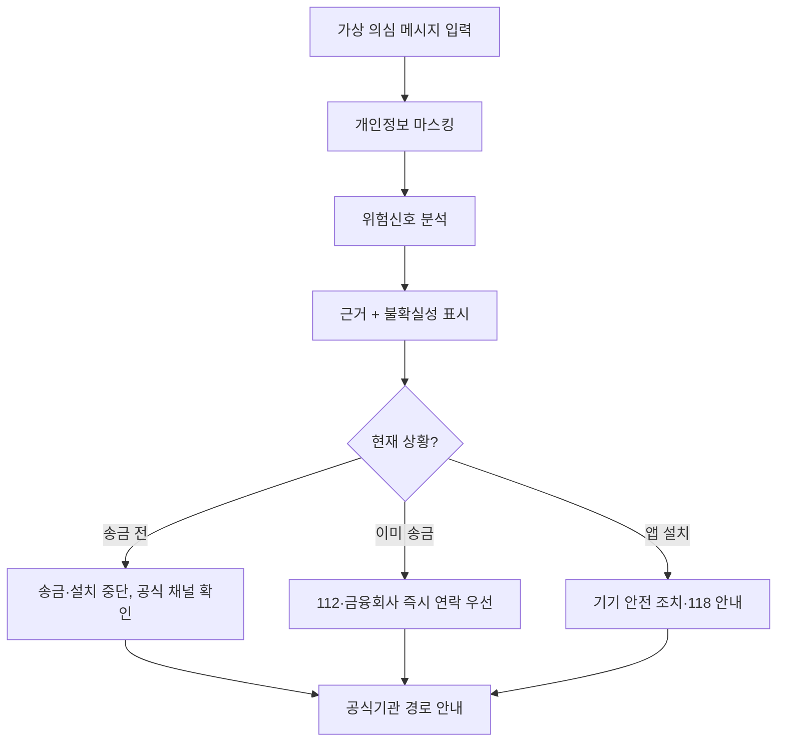

# 01단계 — 기획 (Planning) | K-SAFE 국민안심 AI

> **문제 정의 → 근거 조사 → 사용자·차별성 → 핵심 시나리오 → MVP 결정 → 기획 검증**
>
> 문서 버전: v1.1 · 작성 기준: **2026-10-30** · 해커톤 구현 목표: **24시간**
>
> 진행 상태: **기획 초안 작성 및 근거 확인 완료 / 대회 공식 공고·심사표 확인 대기**

[프로젝트 홈으로](../../README.md) | **[2025~2026 공식 해커톤 심사기준 비교 및 K-SAFE 자체 평가표](JUDGING-CRITERIA-2025-2026.md)**

---

## 0. 한눈에 보는 기획 결론

- **서비스명:** K-SAFE — 국민안심 AI (가칭; 상표·서비스명 중복 검토 필요)
- **한 줄 소개:** 금융사기가 의심되는 문자를 분석해 위험 근거를 쉽게 설명하고, **사용자 상황별 다음 안전행동**을 추천하는 웹 서비스
- **해커톤 주제:** ① AI 기반 추천 서비스 + ② AI 기반 정보보호 서비스
- **핵심 사용자:** 의심 문자 수신자, 이미 송금한 사용자, 악성 앱 설치가 걱정되는 사용자
- **가장 중요한 차별점:** '위험/정상 판정'을 넘어 **상황별 조치·공식 확인 경로·행동 우선순위** 안내
- **구현 원칙:** 24시간 안에 돌아가는 웹 MVP, 실제 개인정보·금융계좌·사고 피해자료 사용 금지

> 대회 이름·주최기관·심사표·제출 형식·대상 상격은 아직 전달받지 않았습니다. 아래의 수상 전략은 *일반적인 해커톤 대비 계획*이며, **장관상 수상이나 자격을 보장하지 않습니다.**

## 1. 문제 정의 (Problem Statement)

### 1-1. 사회적 문제

개인정보 유출 사고 이후 금융회사나 공공기관을 사칭하는 연락을 받은 국민은 발신자가 자기 이름·대출 정보를 안다는 이유로 쉽게 믿을 수 있습니다. 기술적인 '사기 여부 탐지'만으로는, **이미 송금했는지·앱을 설치했는지** 등 현재 상황에 따른 신속한 대응이 부족할 수 있습니다.

**우리가 풀 질문:**

> 의심 메시지를 받은 국민에게, 지금 어떤 조치를 먼저 해야 하는지 **이해하기 쉬운 한국어로 안내할 수 있을까?**

### 1-2. 2026년 근거 확인: 공식 발표와 언론을 구분

| 일자 | 구분 | 확인된 내용 | 기획에 반영 |
|---|---|---|---|
| 2026-10-06 | **금융위원회** | 금융권 개인정보 유출에 따른 보이스피싱·스미싱 **2차 피해 우려**를 경고(소비자경보 '주의'). 당시 **해당 유출 사고로 고객 자금 유출 피해가 확인되지 않았다고 명시** | 피해 확정이 아닌 **사전 예방**으로 문제 정의 |
| 2026-10-05 | **연합뉴스** | 흩어진 개인정보를 AI로 결합할 경우 표적형 피싱에 악용될 위험을 보도 | '내 정보를 안다'는 사칭을 분석 시나리오에 반영 |
| 2026-08-04 | **금융위원회** | 금융·통신·수사 정보의 보이스피싱 공동 대응을 위한 AI 기반 정보공유·분석 플랫폼 **ASAP** 시행 | 공공 대응체계를 대체하지 않고 국민의 행동 안내에 초점 |
| 2026-06-03 | **KISA** | OTT 개인정보 유출을 빙자한 보상·환불 관련 스미싱/피싱 주의 권고 | '유출 보상' 사칭 합성 테스트 사례 |
| 2026-07-16 | **KISA** | 카드사 사칭 계정정지·본인확인 유도 스미싱 경고 | '계정 정지/인증' 합성 테스트 사례 |

**자료 링크:**
1. 금융위원회 (2026-10-06) — [금융권 개인정보 유출사고와 보이스피싱·스미싱 2차 피해 주의](https://www.fsc.go.kr/no010101/87882)
2. 연합뉴스 (2026-10-05) — [은행도 플랫폼도 털렸다…AI로 개인정보 조각 맞춘다](https://www.yna.co.kr/view/AKR20261004035100017)
3. 금융위원회 (2026-08-04) — [보이스피싱 의심정보 ASAP 공유·분석](https://www.fsc.go.kr/no010101/87474)
4. 한국인터넷진흥원(KISA) (2026-06-03) — [OTT 플랫폼 개인정보 유출 악용 스미싱 주의](https://krcert.or.kr/kr/bbs/view.do?bbsId=B0000133&menuNo=205020&nttId=72078)
5. KISA (2026-07-16) — [카드사 사칭 스미싱·피싱 주의](https://www.krcert.or.kr/kr/bbs/view.do?bbsId=B0000133&categoryCode=&menuNo=205020&nttId=72131&pageIndex=1&searchCnd=&searchWrd=)

**주의:** '금융권 개인정보 유출이 실제 AI 표적형 피싱 피해로 이어졌다'는 사실은 위 근거만으로 확인할 수 없습니다. 가능성과 확인된 피해를 구별해 발표합니다.

## 2. 국내 유사 서비스 비교와 차별화

| 비교 대상 | 실제 제공·추진 중인 내용 | K-SAFE에서 집중할 빈틈 |
|---|---|---|
| **KISA 보호나라 스미싱 확인서비스** | 사용자가 의심 메시지를 질의하면 정상·주의·악성 등으로 확인 가능 | 위험 설명 뒤 **송금 전/후 등 단계별 행동 추천**을 UX의 중심에 배치 |
| **시티즌코난 / 피싱아이즈** | 스마트폰 악성앱 탐지, 일부 제휴 금융사와 대응 | 앱을 설치하지 않아도 **웹에서 문자를 붙여넣어** 행동 안내하는 보조 도구 |
| **ASAP (금융당국)** | 금융·통신·수사정보를 기관끼리 공유·분석하는 체계 | 기관 시스템을 흉내 내지 않고 **개인 사용자 중심의 설명·예방 안내** |
| **K-SAFE (제안)** | 메시지 위험 근거 + 현재 상황 질문 + 조치 순서 + 공식 확인/신고 경로 | 위 기능들을 **단일 시연 흐름**으로 통합 |

관련 원문:
- [KISA 보호나라 스미싱 확인서비스](https://www.boho.or.kr/kr/subPage.do?menuNo=205116)
- [시티즌코난(구) — 공식 Google Play 소개](https://play.google.com/store/apps/details?id=com.infinigru.police.phishingeyes)
- [금융위원회 ASAP 발표](https://www.fsc.go.kr/no010101/87474)
- [금융보안원 2026 금융 AI Challenge 안내](https://www.fsec.or.kr/bbs/detail?bbsNo=11997&menuNo=66)

**독창성 판단:** 'AI 피싱 탐지 + 맞춤형 안전 가이드'라는 큰 개념 자체는 이미 경쟁/유사 사례가 있습니다. 따라서 **상황별 행동의 구체성, 쉬운 접근성, 개인정보 처리, AI 설명의 안전성, 검증 품질**로 경쟁해야 합니다. 이 차별성은 기획 가설이며 실증이 필요합니다.

## 3. 대상 사용자 (Persona) 및 핵심 시나리오

| 사용자 | 겪는 문제 | K-SAFE가 해야 할 일 |
|---|---|---|
| A. 송금하기 전 | 금융회사에서 온 것 같은 문자로 입금을 요구받음 | 위험 근거 제시 → **송금·설치 중단** → 공식 대표번호 직접 확인 |
| B. 이미 송금함 | 사기 의심 이후 어떻게 해야 할지 모름 | 분석을 기다리게 하지 않고 **즉시 112·금융회사 지급정지 문의**를 최상단 제시 |
| C. 앱을 설치함 | 휴대전화 침해 가능성을 우려함 | 네트워크·기기 안전 수칙 및 118 등 공식 상담 경로 안내. **자체 원격 제어는 금지** |
| D. 고령·초보 사용자 | 보안용어 이해 어려움 | 큰 글씨, 짧은 문장, 번호가 매겨진 안전행동 안내 |

### 시연 스토리 (약 2~3분)

1. 합성 금융회사 사칭 문자 입력: '고객님, 대출 전환을 위해 기존 대출 상환과 새 앱 설치가 필요합니다.'
2. 개인정보 가림(마스킹) 상태를 표시하고 위험 근거 설명.
3. **[아직 송금 전]** 선택 시 송금 중단·공식 채널 확인 안내.
4. **[이미 송금함]**으로 바꾸면 조치 우선순위가 즉시 달라짐: 112/금융회사 연락 우선.
5. 정상 안내문 또는 경계 사례를 분석해 **불확실성 표기**와 오탐 가능성 설명.
6. 테스트 표·보안 보호조치·공개 시연 URL 제시.

## 4. 해커톤 MVP 범위 (MoSCoW 우선순위)

| 분류 | 기능 | 이유 |
|---|---|---|
| **Must(필수)** | 메시지 붙여넣기 · 사용자 상황 선택 | 실제 사용 흐름의 출발점 |
| **Must** | 전화번호·계좌번호 등 가림, 로그 최소화 | 정보보호 주제의 기본 |
| **Must** | 위험 신호 규칙 + AI 설명 및 불확실성 표시 | 정보보호와 AI 기술성 입증 |
| **Must** | **상황별 안전행동 추천** | 추천 주제의 핵심 차별화 |
| **Must** | 공식 기관 안내·안전한 수동 확인 경로 | 국민 안전성과 실행 가능성 |
| **Must** | 합성 사례 테스트·시연 가능한 URL | 완성도 및 실증 |
| **Should(권장)** | 읽기 쉬운 큰 글씨 모드·대응 안내 복사 | 접근성과 발표 효과 |
| **Could(선택)** | QR·이미지 문자 추출, 간단한 보고서 | 남는 시간이 있을 때만 |
| **Won't(이번 제외)** | 실시간 통화 녹음·가로채기, 은행 API 직접 차단, 신고 자동 접수, 실제 유출정보 조회 | 24시간과 권한·안전 제약 |

## 5. 핵심 제품 흐름

## 6. 수상 전략: 심사위원에게 보여줄 증거

| 심사 관점 | 증거 | 현재 상태 |
|---|---|---|
| 사회적 필요성 | 최신 공식 보도·언론 원문 5건 | 문헌 확인 |
| AI 추천 서비스 | 같은 메시지라도 상황에 따른 권고 차이 | 구현 필요 |
| AI 정보보호 | 개인정보 자동 가림·위험 근거·안전한 입력 처리 | 구현 필요 |
| 독창성 | 보호나라·시티즌코난·ASAP과 사용 목적 차이 | 기획 가설 |
| 기술 구현 | 공개 URL, 실행 가능한 코드, 2~3분 라이브 시연 | 구현 필요 |
| 성능·보안 | 합성 시험 결과, 위험 누락률·오경보·마스킹 검증 | 측정 필요 |
| 지속 가능성 | 추후 공공·금융기관 연계 가능성 및 제약 명시 | 기획 가설 |

**검증 목표(측정 결과 아님):** 합성 예제 최소 30건(의심·정상·경계 사례 혼합), 핵심 시연 3종 PASS, 고위험 응답 시 공식 연락 안내 우선 출력. 정확도 목표 수치는 02 요구사항 단계에서 시험 구성에 맞춰 확정합니다.

## 7. 프로젝트 위험 및 대응

| 위험 | 대응 |
|---|---|
| 실제 금융사기 여부를 틀리게 판별 | '안전함' 단정 금지, 불확실성/공식 확인 안내 |
| 개인정보가 LLM에 그대로 전송 | 전송 전 마스킹, 서버 로그 최소화, 테스트는 합성 데이터 |
| 악성 메시지에 포함된 프롬프트 인젝션 | 입력 문구를 **데이터로만 취급**, 외부 명령·URL 자동 실행 금지 |
| API 할당량·네트워크 장애 | 핵심 규칙 기반 안내를 폴백(Fallback, 대체 동작)으로 제공 |
| 공개 저장소에 비밀정보 유출 | .gitignore + 환경변수 + 검증 절차 |
| 발표 중 인터넷 장애 | 로컬 시연과 캡처·녹화 영상 준비 |
| 공식 해커톤 요구사항과 불일치 | 공고·심사표 수신 후 01 문서 즉시 수정 |

## 8. 01단계 검증 게이트 (Gate)

- [x] 국민 안전과 금융사고 예방 문제 정의
- [x] 정부·언론 발표 날짜 및 원문 링크 확인
- [x] 기존 서비스와 겹치는 영역 인정 및 차별화 가설 기술
- [x] 핵심 사용자와 대표 시연 시나리오 정의
- [x] 24시간 MVP 필수/제외 기능 분리
- [x] 개인정보·안전 제약 기획에 반영
- [x] **2025~2026 다른 해커톤의 공식 심사기준 비교 및 K-SAFE 자체 평가표 작성** (참고자료 검토 완료)
- [ ] **실제 참가할 해커톤의 공식 공고/심사표/제출 양식 확인** (자료 미제공)
- [ ] **아이디어 최종 승인 및 02 요구사항 단계 진입** (진행 전 확인)

**판정:** 기획 문서·다른 대회 공식 심사기준 참고 **PASS**, 전체 단계 완료는 **REVIEW_REQUIRED(공식 기준·최종 승인 대기)**. 다음 단계로 넘어가기 전에 이 문서의 범위와 대회 조건을 확인합니다.

## 9. 용어집

| 한글 | 영어·약어 | 쉬운 설명 |
|---|---|---|
| 최소기능제품 | Minimum Viable Product (MVP) | 꼭 필요한 기능만 돌아가는 제품 |
| 상황인지형 추천 | Context-aware Recommendation | 현재 상황을 고려해 다음 행동을 제안 |
| 설명 가능한 AI | Explainable AI (XAI) | AI 판단 이유와 한계를 설명 |
| 스미싱 | SMS Phishing (Smishing) | 문자메시지를 이용한 사기 |
| 보이스피싱 | Voice Phishing | 전화·음성을 이용한 사기 |
| 개인정보 가림 | Data Masking | 전화번호·계좌번호 등을 숨김 |
| 대체 동작 | Fallback | AI가 중단돼도 최소 안전 안내 유지 |
| 수용 기준 | Acceptance Criteria | 완료 여부를 객관적으로 확인하는 기준 |

---

**다음 예정 작업:** `docs/02-requirements/README.md`에 기능 요구사항(FR), 비기능 요구사항(NFR), 보안 요구사항(SR), 수용 기준 및 시험 매핑을 작성합니다. **현재는 작성하지 않았습니다.**
