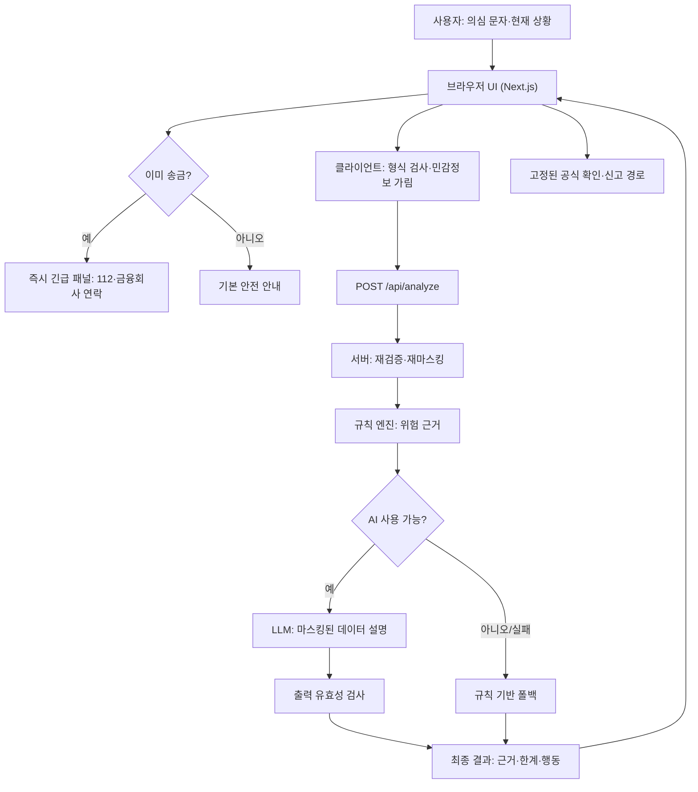
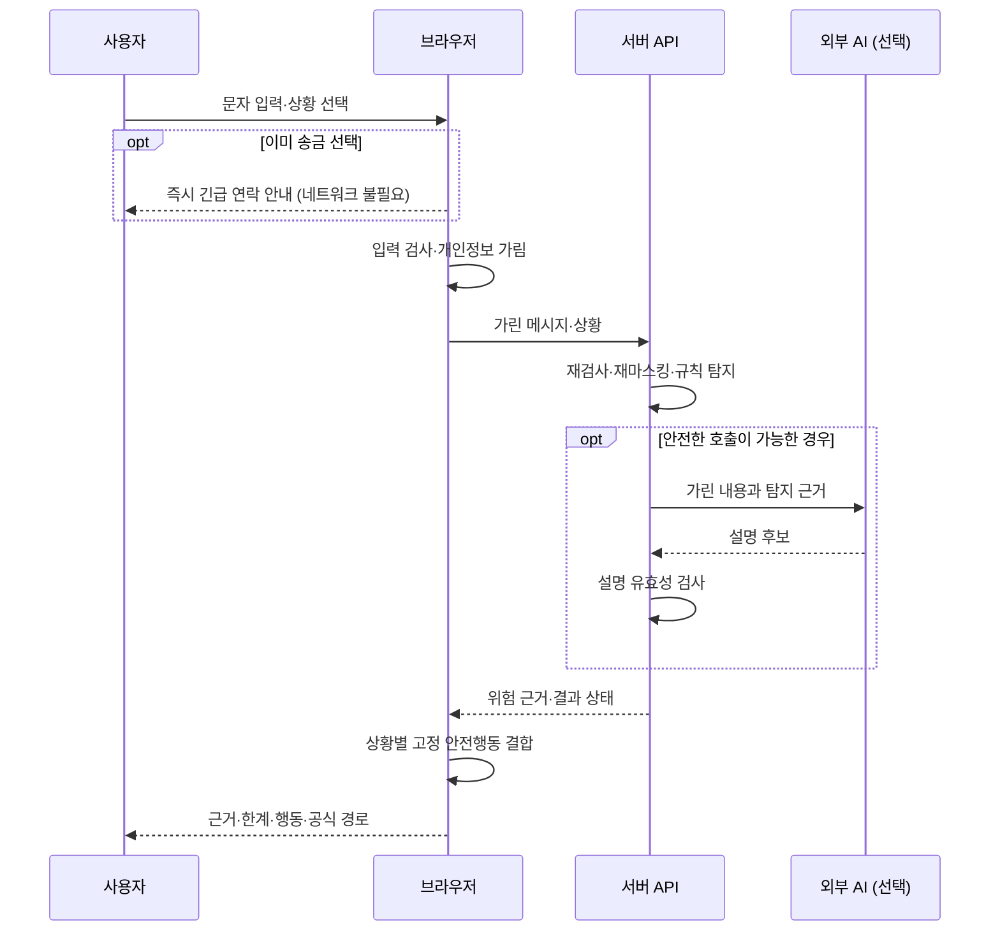

# 03단계 — K-SAFE 시스템·화면·보안 설계

> 버전 v1.0 · 2026-10-30 · 상태: **설계 문서 작성 단계 / 코드·실행 테스트·배포 미수행**
>
> [프로젝트 홈](../../README.md) · [01 기획](../01-planning/README.md) · [02 요구사항](../02-requirements/README.md) · [심사기준 참고](../01-planning/JUDGING-CRITERIA-2025-2026.md)

## 0. 한눈에 보기: 무엇을 설계하는가?

**목표:** 사용자가 의심 문자를 넣고 '송금 전/이미 송금/앱 설치/모름' 중 상황을 선택하면 위험 근거와 **지금 해야 할 안전행동**을 보여주는 1일 해커톤용 웹서비스(MVP, Minimum Viable Product).

핵심 판단: **긴급 안내는 AI보다 먼저**, 개인정보는 **외부 전송 전에 가림**, AI가 장애일 때는 **규칙 기반으로 대체**, 신고·금융 조치는 **사용자가 공식 기관에 직접 요청**하도록 설계한다.

**가장 중요한 제한:** 이 서비스는 사기 확정 판정, 안전 보증, 실제 지급정지 실행, 금융기관/경찰 연동을 하지 않는다. 테스트는 합성 데이터만 사용한다. 실제 참가 대회의 공식 심사 기준은 미확인이다.

## 1. 시스템 구성(Architecture, 아키텍처)



**개발 구성:** Next.js App Router + TypeScript + 서버 분석 API 1개 + 결정적 위험 규칙 + 선택적 대형언어모델(LLM, Large Language Model). 데이터베이스(DB), 회원가입, 거래내역 저장 기능은 이번 MVP에서 제외한다.

- 웹 프레임워크(Framework): Next.js, 서버 엔드포인트(Endpoint): POST /api/analyze
- LLM의 역할: 위험 신호를 **설명만** 한다. 행동 지침의 최종 결정은 규칙/상황 테이블이 한다.
- 외부 유료 AI 연결이 실패하거나 안전한 요청 제한을 구현하지 못하면 규칙 기반 시연으로 대체하며, AI 사용 실적을 허위로 발표하지 않는다.
- 배포 후보: HTTPS 지원 플랫폼. 실제 배포는 06단계에서 진행한다.

## 2. 화면 설계(UI/UX, 사용자 화면·경험)

### 2-1. 텍스트 와이어프레임(Wireframe, 화면 배치 초안)

```text
┌───────────────────────────────────────────┐
│ 🇰🇷 K-SAFE 국민안심 AI                     │
│ 금융사기를 의심하는 순간, 먼저 확인하세요 │
│ [실제 주민번호·계좌·비밀번호 입력 금지]   │
├───────────────────────────────────────────┤
│ ① 의심 메시지를 입력하세요                │
│ ┌───────────────────────────────────────┐ │
│ │ 문자를 붙여넣거나 가상 예시를 선택    │ │
│ └───────────────────────────────────────┘ │
│ [가상 예시 1] [예시 2] [예시 3]            │
│                                          │
│ ② 현재 상황                             │
│ ○ 송금 전   ○ 이미 송금                  │
│ ○ 앱 설치   ○ 잘 모르겠음                │
│                                          │
│ [! 이미 송금 선택 즉시 긴급 안내 표시 !] │
│ 112 또는 거래 금융회사에 즉시 연락       │
│                                          │
│ [위험 신호 분석하기]                     │
├───────────────────────────────────────────┤
│ ③ 위험 신호와 이유 / 불확실성             │
│ ④ 지금 해야 할 행동 1, 2, 3               │
│ ⑤ 공식 확인·신고 경로                    │
│ ※ 분석만으로 사기 여부 확정 불가          │
└───────────────────────────────────────────┘
```

### 2-2. 상태별 사용자 경험

| 상황 | 분석 전에 보일 내용 | 분석 후 핵심 추천 |
|---|---|---|
| 송금 전 | 송금·설치 중단 및 공식 채널 확인 | 사칭·선입금·앱 설치 등 신호별 설명 |
| **이미 송금** | **즉시 112/금융회사에 지급정지 문의** | 증거 보존·추가 송금 금지 |
| 앱 설치함 | 추가 인증·송금 중단, 다른 안전한 기기 이용 | 공식 상담 및 기기 안전 조치 |
| 잘 모르겠음 | 송금·설치 중단 및 독립적인 출처 확인 | 불확실성 안내, 추가 확인 단계 |

**우선순위:** 사용자의 현재 상황 → 긴급 행동 → 위험 근거 → 공식 경로. 모바일에서도 글자가 잘리지 않아야 하며, 색상뿐 아니라 텍스트로 위험을 표시한다.

### 2-3. UI 상태

- **idle(대기):** 메시지 입력과 상황 선택
- **invalid(입력 오류):** 빈 메시지/2,000자 초과, AI 호출 금지
- **loading(분석 중):** 중복 클릭 방지, 긴급 안내 유지
- **success(정상 결과):** 위험 근거·한계·추천 표시
- **fallback(대체):** 'AI 설명 불가, 기본 위험 신호 안내'를 명확히 표시
- **error(오류):** 원문/비밀키 노출 없이 기본 안전 수칙 표시

접근성(Accessibility): 입력 label, 키보드 조작, 명확한 포커스, 스크린리더용 aria-live 안내, 충분한 대비, 모바일 반응형 레이아웃.

## 3. 데이터 흐름(Sequence, 요청 순서)



**개인정보 보호 경계:** 원본 메시지의 민감정보를 **브라우저에서 먼저 가리고**, 서버에서 다시 검사한다. **정규식만으로 모든 개인정보를 탐지할 수는 없으므로** 실제 금융정보를 입력하지 않도록 강하게 고지한다. 원문 메시지, API 비밀키, AI 요청 본문을 애플리케이션 로그에 기록하지 않는다.

## 4. API 설계(Data Contract, 데이터 계약)

- 메서드: **POST /api/analyze**, 형식: JSON
- 본문: **message(마스킹된 텍스트 1~2,000자)**, **situation(4가지 중 하나)**
- 상황 값: before_transfer / already_transferred / installed_app / unsure
- 요청 실패: HTTP 400(유효하지 않은 입력), 429(요청 제한), 500(서버 장애)
- 서버는 민감정보·스택트레이스·비밀키를 응답에 포함하지 않는다.

**합성 요청 예시**

```json
{
  "message": "저금리 전환을 위해 먼저 상환금을 보내고 전용 앱을 설치하세요.",
  "situation": "before_transfer"
}
```

**예상 응답 형식 (실제 동작 결과 아님)**

```json
{
  "risk_level": "warning",
  "signals": ["upfront_payment", "unverified_app_install"],
  "reasons": ["선입금 요구", "출처 불분명한 앱 설치 유도"],
  "uncertainty_notice": "이 결과만으로 사기 여부를 확정할 수 없습니다.",
  "recommended_actions": [
    "송금 및 앱 설치를 중단하세요.",
    "금융회사 공식 대표번호를 직접 확인하세요."
  ],
  "source": "rules_with_ai_explanation",
  "analysis_status": "completed"
}
```

가능한 값:
- risk_level: warning / review / no_clear_signal. **no_clear_signal ≠ 안전함**.
- source: rules_with_ai_explanation / rules_fallback
- analysis_status: completed / fallback
- 긴급 패널은 API 결과를 기다리지 않고 UI에서 동작하도록 별도로 구현한다.

## 5. AI 위험 분석·추천 설계

| 규칙 신호 | 합성 예시 | 사용자에게 표시할 근거 |
|---|---|---|
| upfront_payment | 대출 전환을 위해 먼저 상환금 송금 | 선입금 요구 |
| unverified_app_install | 전용 앱을 지금 설치 | 출처 불명 앱 설치 유도 |
| urgent_pressure | 지금 즉시 처리하지 않으면 계정 정지 | 긴급성 이용·압박 |
| impersonation | 은행/공공기관 담당자입니다 | 기관 사칭 가능성 |

- **규칙(Rules):** 위험 신호와 근거를 일관되게 반환. 단어가 있다는 사실만으로 실제 사기를 확정하지 않는다.
- **AI(LLM):** 마스킹된 내용을 쉬운 한국어로 요약·설명한다. 사용자 입력 속 명령은 모두 분석 데이터일 뿐 지시사항이 아니다.
- **추천(Recommendation):** 송금 전/후, 앱 설치 여부에 따라 **고정된 안전행동 추천표**에서 선택한다. AI 텍스트로 고정 안전조치를 삭제·변경하지 않는다.
- **폴백(Fallback):** 호출 오류, 할당량 초과, 응답 검증 실패 시 규칙 엔진 결과와 긴급 안내를 유지한다.
- **정량 검증:** 05단계에서 위험 15, 정상 10, 경계·교란 5 이상(총 30 이상) **합성 사례**로 누락/오경보·가림·추천 적절성을 측정. 아직 측정 결과 없음.

## 6. 예정 소스코드 구조(04 구현 단계에서 생성)

```text
src/
  app/
    page.tsx                   # 단일 사용자 화면
    layout.tsx
    api/analyze/route.ts       # 분석 API
  components/
    MessageForm.tsx            # 문자 입력·예시
    SituationPicker.tsx        # 현재 상황 선택
    EmergencyBanner.tsx        # 송금 후 즉시 안내
    AnalysisResult.tsx         # 위험 근거·AI 설명
    ActionGuide.tsx            # 안전행동 추천
  lib/
    redact.ts                  # 개인정보 가림
    risk-engine.ts             # 결정적 규칙
    ai-explainer.ts            # AI 설명·폴백
    recommend.ts               # 상황별 고정 안전행동
    schema.ts                  # 요청/응답 검증
    official-links.ts          # 사전 승인 공식 경로
tests/
data/synthetic/
```

**주의:** 위 파일과 폴더는 **구현 예정**이며 현재 존재하는 파일이 아니다. 04단계에서 실제 생성 후 검증한다.

## 7. 위협모델(Threat Model, 위험 요소와 대응)

| 위협 | 설계된 방어 | 검증 ID |
|---|---|---|
| 개인정보·계좌번호 외부 전달 | 브라우저 사전 가림 + 서버 재검사 + 합성 사례 | SR-01, TS-01 |
| API 키 노출 | 서버 환경변수만 사용, 브라우저/저장소 제외 | SR-02, TS-02 |
| 프롬프트 인젝션(입력의 악성 명령) | 입력은 데이터로만 처리, AI는 설명만 수행 | SR-03, TS-03 |
| 악성 URL 자동 접속 / SSRF | 메시지 URL에 서버 자동 방문·미리보기 금지 | SR-04, TS-04 |
| 원문 유출·과도한 로깅 | DB 저장 없음, 원문·메시지 로깅 금지 | SR-05, TS-05 |
| 공개 API 남용·비용 폭증 | 입력 길이 및 서버측 실효성 있는 요청 제한 | SR-06, TS-06 |
| AI의 잘못된 송금 권유 | 안전행동 고정표·안전 확정 문구 금지 | SR-07, TS-07 |
| AI 지연·중단 | 긴급 UI 즉시 표시 + 규칙 기반 폴백 | NFR-02, TC-12 |

**실무 주의:** 서버리스(Serverless) 여러 인스턴스 사이에서 **프로세스 메모리만으로 요청량을 제한하는 방식은 신뢰할 수 없다**. 호스팅 사업자의 제한 기능 또는 관리형 저장 기반 제한을 적용한다. 제한을 구현하지 못하면 외부 유료 AI 호출을 비활성화한 규칙 기반 데모로 운영한다. API 제공자의 데이터 보존 정책도 별도로 점검한다.

## 8. 요구사항 → 화면·코드 → 시험 매핑

| 요구사항 | 설계 위치 | 완료를 확인할 시험 |
|---|---|---|
| FR-01, FR-10 | MessageForm | TC-01, TC-10 입력·합성 예시 |
| FR-02 | SituationPicker | TC-02 상황 4가지 선택 |
| FR-03, SR-01,05 | redact + API | TC-03, TS-01,05 개인정보 가림·로그 |
| FR-04 | risk-engine | TC-04 위험 신호 근거 |
| FR-05, NFR-02 | ai-explainer | TC-05,12 정상·장애 폴백 |
| FR-06, SR-07 | AnalysisResult | TC-06, TS-07 안전 단정 금지 |
| FR-07 | EmergencyBanner + recommend | TC-07,11 이미 송금 즉시 안내 |
| FR-08 | ActionGuide + official-links | TC-08 공식 확인·신고 안내 |
| FR-09, NFR-03,04 | 모든 UI | TC-09,13,14 접근성·모바일 |
| SR-02,03,04,06 | API·설정·출력 검증 | TS-02,03,04,06 |
| NFR-05,06,07 | 배포·README·운영 | TC-15,16,17 |

**04단계 구현 완료**는 구현 자체의 PASS 여부이며, **05단계 기능·보안 검증**, **06단계 배포**, **07단계 운영**, **08단계 발표**를 대신하지 않는다.

## 9. 24시간 해커톤 우선 구현 순서

1. Next.js TypeScript 초기화, 로컬 개발 서버 확인
2. 상황 선택·긴급 안내 UI(외부 서비스 없이 동작)
3. 마스킹과 기본 위험 탐지 규칙 및 단위시험
4. POST 분석 API·결과 화면·상황별 행동 추천
5. LLM 설명 연결(안전한 호출·비용 통제가 가능한 경우), 폴백
6. 모바일·접근성·공식 경로·합성 예시 정리
7. 보안/기능 테스트 → HTTPS 배포 → 운영 점검 → 2~3분 시연

**시간 부족 시 먼저 제외:** 음성 분석, QR, PDF 내보내기 등 선택 기능. **제외 금지:** 송금 후 긴급안내, 비밀키 보호, 안전 단정 금지, 합성 데이터 사용, 기본 오류 대응.

## 10. 03단계 설계 완료 판정(Gate)

- [x] FR-01~10 및 NFR-01~07, SR-01~07을 설계와 시험에 연결
- [x] Mermaid 아키텍처 및 요청 순서 다이어그램 작성
- [x] 사용자 화면 시안과 화면 상태 정의
- [x] 입력/응답 JSON 데이터 계약 및 오류 정책 정의
- [x] 개인정보 가림·AI 폴백·긴급 안내 설계
- [x] 보안 위협모델 및 대응 시험 연결
- [ ] 실제 서비스 코드 생성·실행(04단계)
- [ ] 자동·수동 테스트 실행(05단계)
- [ ] HTTPS 배포(06단계)
- [ ] 참가 대회 공식 공고·심사 기준 대조(자료 대기)

**판정:** **DESIGN_DOCUMENT_PASS**(문서 설계 완료). **IMPLEMENTATION_NOT_STARTED**, **TEST_NOT_RUN**. 아직 실서비스 작동 여부는 확인되지 않았다.

**다음 작업:** docs/04-implementation/README.md와 실제 Next.js 소스코드 구현. 단계별 명령 실행 결과를 확인하며 진행.
